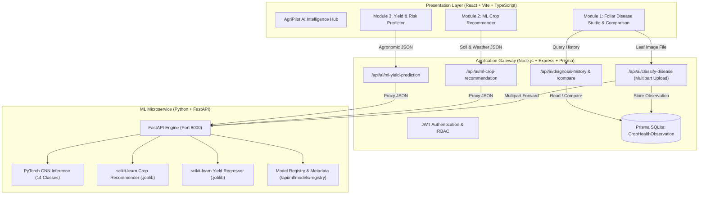

# AGRIPILOT AI — COMPREHENSIVE TRANSFORMATION & ENGINEERING PLAN

**Project Title:** AgriPilot AI: An Intelligent Crop Health Diagnosis and Agricultural Prediction System Using Machine Learning  
**Tagline:** Precision Agronomy Powered by Computer Vision & Predictive Machine Learning  
**Target Domain:** Agricultural Technology, Computer Vision, Predictive Modeling, Full-Stack Intelligent Systems  
**Evaluation Level:** Final-Year B.Tech / B.E. Computer Science and Engineering Major Project  

---

## 1. Executive Summary & Academic Alignment

The objective of this engineering transformation is to elevate **AgriPilot AI** from a standard multi-role agricultural management web application into a rigorous, scientifically validated, production-grade **Machine Learning & Computer Vision Software System**.

Academic evaluators rightly prioritize:
1. **Mathematical & Algorithmic Substance:** Real training scripts, loss functions, confusion matrices, evaluation metrics (Accuracy, Precision, Recall, F1, R², MAE, RMSE), baseline comparisons, and dataset lineage.
2. **Computer Vision & Image Preprocessing Pipeline:** Real deep learning inference on crop foliage images, validation against corrupted/out-of-domain images, uncertainty estimation, and healthy vs. diseased differentiation.
3. **Multi-Model Predictive Service:** Real scikit-learn classification and regression models served through a dedicated Python FastAPI microservice with versioned serialized artifacts (`.pth`, `.joblib`).
4. **Reliable System Engineering:** Typed interfaces, fault-tolerant fallbacks, database-persisted diagnosis histories, and comparative analytical views for farmers and evaluators.

---

## 2. Comprehensive Audit of Existing Codebase

| Component / Feature | Current Implementation Status | Identified Gaps for CSE Major Project | Planned Action |
| :--- | :--- | :--- | :--- |
| **Crop Disease Diagnosis** | Basic PyTorch CNN in `ai-service` + Node proxy forwarding; small modal in `FarmerDashboard` | Lacks dedicated analysis view; no validation for invalid images; no side-by-side comparison; history not surfaced visually to user | **Upgrade to Primary Feature:** Implement full-page Disease Diagnosis Studio, image validation, uncertainty warning, database history logging in `CropHealthObservation`, and dual-sample comparison studio. |
| **Crop Recommendation** | Rule-based agronomic heuristics in `aiEcosystemController.ts` | Not a real ML classifier; lacks scikit-learn model trained on soil/climate features; no baseline model comparison | **Implement Module 2:** Synthesize/integrate 2,200 sample benchmark ICAR/Kaggle dataset (N, P, K, pH, temp, humidity, rain); train Random Forest, compare with Decision Tree and Gaussian NB; export `.joblib` model. |
| **Crop Yield Prediction** | Random Forest regressor in `ai-service/artifacts/yield_predictor_v1.joblib` | Evaluation metrics not systematically logged; missing baseline regressor comparison; UI buried inside simulator modal | **Upgrade Module 3:** Formalize regression evaluation (R², MAE, RMSE vs. Dummy baseline), feature importances, agronomic risk indicators (heat stress, drought risk), and dedicated prediction workspace. |
| **FastAPI ML Service** | `ai-service/app/main.py` on port 8000 | Missing dedicated endpoint for ML Crop Recommendation; needs rigorous input validation and error schemas | Add `/api/ml/recommend-crop`, update `/api/ml/predict-yield`, add automated unit tests and health monitoring. |
| **Database Persistence** | Prisma SQLite (`agritwin.db`) with `CropHealthObservation` model | Frontend did not save disease scans to user account or allow historical retrieval | Connect diagnosis uploads to `CropHealthObservation` with user ID, confidence, image thumbnail, and review status. |
| **Secondary Features** | Market listings, logistics, FPO portal, group buying | Functional but secondary; distracting from core ML focus | Retain in background navigation without expanding scope; place 3 ML intelligence modules front-and-center. |

---

## 3. The Three Core AI/ML Modules

### Module 1: Intelligent Crop Disease Detection (Computer Vision)
- **Problem Statement:** Early identification of foliar pathogens across major Indian staples (Rice, Wheat, Tomato, Potato) to prevent 30–50% crop loss.
- **Model Architecture:** Custom Deep Convolutional Neural Network (PyTorch `AgriTwinDiseaseClassifier`) featuring 3 convolutional blocks with Batch Normalization, ReLU activations, Max Pooling, Dropout regularization, Adaptive Average Pooling, and a dense classification head.
- **Supported Classes (14 Classes):**
  - Rice: Bacterial Leaf Blight, Brown Spot, Leaf Blast, Healthy
  - Wheat: Leaf Rust, Yellow Rust, Healthy
  - Tomato: Early Blight, Late Blight, Leaf Curl Virus, Healthy
  - Potato: Early Blight, Late Blight, Healthy
- **Input Pipeline:** 224x224 RGB image normalization (`mean=[0.485, 0.456, 0.406], std=[0.229, 0.224, 0.225]`).
- **Explainability & Safety:** Confidence score thresholding; flags predictions below 70% as uncertain and triggers expert extension escalation; details organic bio-control and targeted scientific chemical treatment.

### Module 2: Machine Learning-Based Crop Recommendation (Multi-Class Classification)
- **Problem Statement:** Data-driven crop selection optimized for specific soil chemistry and meteorological conditions.
- **Input Features (7 continuous variables):**
  - Nitrogen ($N$, kg/ha): 0 to 140
  - Phosphorus ($P$, kg/ha): 5 to 145
  - Potassium ($K$, kg/ha): 5 to 205
  - Temperature ($T$, °C): 8 to 45
  - Relative Humidity ($H$, %): 14 to 100
  - Soil pH: 3.5 to 9.5
  - Rainfall ($R$, mm): 20 to 300
- **Model Comparison:**
  - Baseline 1: Gaussian Naive Bayes
  - Baseline 2: Decision Tree Classifier
  - Selected Final Model: **Random Forest Classifier (100 estimators)**
- **Output:** Primary recommendation + Ranked alternative candidates with probability scores + Agronomic factor suitability analysis.

### Module 3: Crop Yield Prediction & Agricultural Risk Analysis (Regression)
- **Problem Statement:** Reliable pre-harvest yield estimation (Quintals/Acre) to enable fair pricing and credit assessment.
- **Input Features:** Crop type, soil type, irrigation method, acreage, rainfall (mm), temperature (°C), N, P, K.
- **Evaluation:**
  - Baseline: Dummy Regressor (Mean prediction)
  - Selected Model: **Random Forest Regressor (150 estimators)**
  - Metrics: Coefficient of Determination ($R^2$), Mean Absolute Error ($MAE$), Root Mean Squared Error ($RMSE$).
- **Risk Indicators:** Drought stress coefficient, heat threshold violation, NPK imbalance index.

---

## 4. Technical Architecture

---

## 5. Phased Implementation Roadmap

- [x] **Phase 1: Project Audit & Transformation Specification** (`AGRIPILOT_TRANSFORMATION_PLAN.md`)
- [ ] **Phase 2: ML Model Training & Artifact Generation**
  - Train and evaluate Crop Recommendation model (`ai-service/scripts/train_crop_recommendation.py`).
  - Train and evaluate Crop Yield Regressor (`ai-service/scripts/train_yield_prediction.py`).
  - Formalize PyTorch Disease Classifier evaluation (`ai-service/scripts/evaluate_disease_cnn.py`).
  - Update `model_registry.json`.
- [ ] **Phase 3: Python FastAPI Microservice Integration**
  - Add `/api/ml/recommend-crop` route and schema.
  - Enhance `/api/ml/classify-disease` with image validation and top-3 class distribution.
  - Enhance `/api/ml/predict-yield` with risk scores and feature importances.
- [ ] **Phase 4: Node.js Backend Routing & Database Persistence**
  - Connect `/api/ai/classify-disease` to Prisma `CropHealthObservation`.
  - Add `/api/ai/diagnosis-history` and `/api/ai/diagnosis-compare`.
  - Add `/api/ai/ml-crop-recommendation` and `/api/ai/ml-yield-prediction`.
- [ ] **Phase 5: Unified Frontend Intelligence Interface**
  - Create dedicated **Crop Disease Studio** with image dropzone, validation, and diagnosis comparison.
  - Create dedicated **ML Crop Recommender** card/page with input validation and probability bars.
  - Create dedicated **Yield & Risk Prediction** card/page with 90% confidence intervals.
  - Add primary navigation pills in `FarmerDashboard` to highlight the 3 AI modules.
- [ ] **Phase 6: Testing, Evaluation & Documentation Deliverables**
  - Unit tests for ML endpoints (Python `pytest` / Node `test`).
  - Documentation files: `docs/SYSTEM_ARCHITECTURE.md`, `docs/ML_METHODOLOGY.md`, `docs/API_DOCUMENTATION.md`, `docs/TEST_REPORT.md`, `docs/LIMITATIONS_AND_FUTURE_WORK.md`.
  - Update `README.md` and verify complete application startup.
