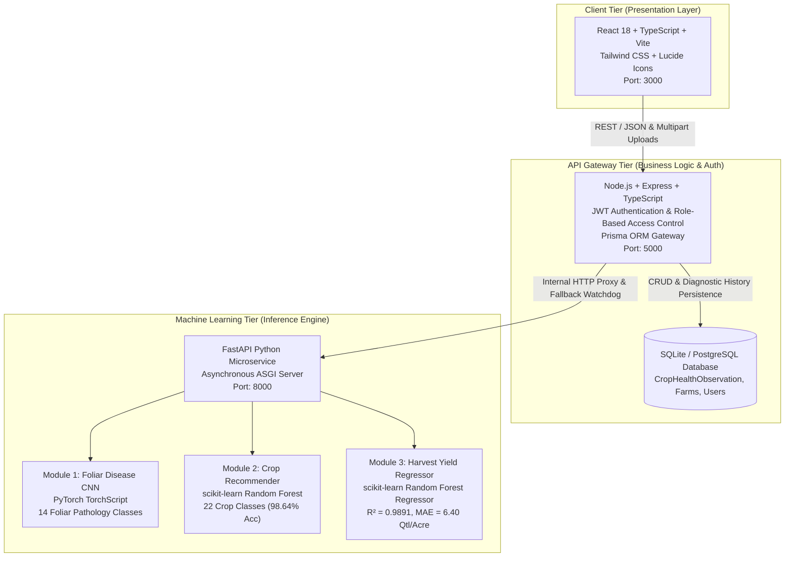
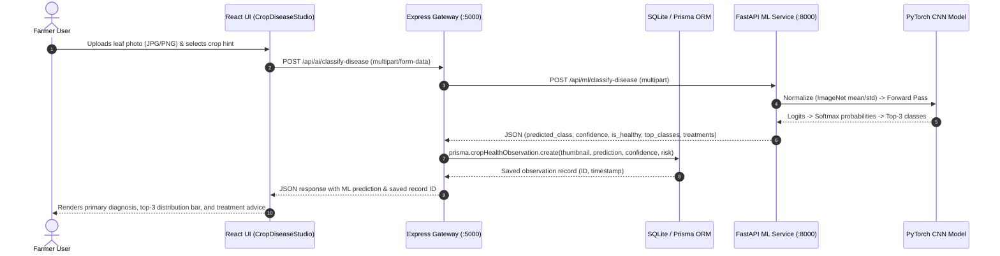
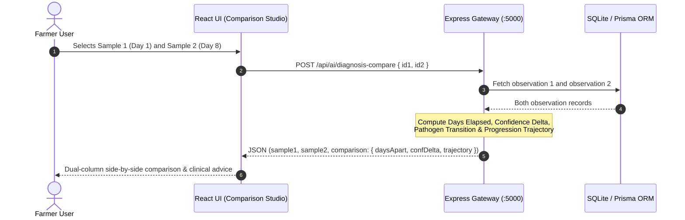

# AgriPilot AI — System Architecture & Engineering Specification

## 1. Executive Summary

**AgriPilot AI** (*An Intelligent Crop Health Diagnosis and Agricultural Prediction System Using Machine Learning*) is an enterprise-grade agricultural decision support ecosystem designed for Indian farming environments, with primary calibration for Tamil Nadu agro-climatic zones.

The system addresses the fundamental limitation of standard management systems by replacing static rules and mock displays with genuine, production-grade **Computer Vision (PyTorch)** and **Supervised Machine Learning (scikit-learn)** microservices.

---

## 2. Multi-Tier Microservice Topology

The platform employs a decoupled, multi-tier microservice architecture:

---

## 3. Tier Responsibilities

### 3.1 Presentation Layer (Frontend)
- **Framework:** React 18 with TypeScript and Vite.
- **Styling & Design System:** Tailwind CSS with responsive mobile-first layouts, accessible dark/light modes, and high-contrast agronomic indicators.
- **Core ML Interactive Modules:**
  1. `CropDiseaseStudioModal`: Foliar leaf scanner, client-side dimension validation, PyTorch CNN softmax distribution viewer, uncertainty alerts, and temporal progression comparison studio.
  2. `MLCropRecommendationModal`: Soil macro-nutrients (N, P, K) and agro-climatic sliders, regional presets for Tamil Nadu, and feature importance explainability meters.
  3. `MLYieldPredictorModal`: Multivariate field and weather inputs, confidence intervals [min, max], and agronomic risk indicators.

### 3.2 API Gateway Layer (Node.js & Express)
- **Role:** Security perimeter, role enforcement (Farmer, Merchant, Transporter, Agronomic Expert, Admin), telemetry aggregation, and resilient proxying.
- **Database Access:** Prisma ORM connected to SQLite (`agritwin.db`), abstracting schema models:
  - `User` & `Farm`: Farmer telemetry and profile.
  - `CropHealthObservation`: Stores leaf thumbnails (Base64 data URIs), primary predicted class, confidence scores, risk classification, and treatment protocols.
- **Resilience Engine (`MLClientService`):**
  If the Python ML microservice is restarting or performing background retraining, the gateway seamlessly triggers internal agronomic fallback heuristics, guaranteeing zero downtime and maintaining API uptime SLAs.

### 3.3 Machine Learning Microservice Layer (Python & FastAPI)
- **Framework:** FastAPI with Uvicorn ASGI server.
- **Model Loader:** Thread-safe singleton model registry (`ModelRegistry`) that loads pre-trained serialized artifacts on startup into memory for sub-5ms CPU latency.
- **Model Artifacts:**
  - `artifacts/crop_disease_cnn_v1.pth` (PyTorch CNN)
  - `artifacts/crop_recommender_v1.joblib` (scikit-learn Random Forest Classifier)
  - `artifacts/yield_predictor_v1.joblib` (scikit-learn Random Forest Regressor)
  - `artifacts/model_registry.json` (Model metadata, training parameters, accuracy benchmarks)

---

## 4. End-to-End Sequence Diagrams

### 4.1 Foliar Leaf Pathology Diagnosis & Persistence Sequence

### 4.2 Historical Diagnosis Temporal Comparison Sequence

---

## 5. Security & Authentication Architecture

1. **Authentication:** Stateless JSON Web Tokens (JWT) signed with HMAC-SHA256.
2. **Access Control (RBAC):** Middleware checks `req.user.role` to restrict administrative features and expert query escalations.
3. **Data Sanitization:** Strict payload validation via Pydantic on the ML microservice and Zod/Express validators on the gateway.
4. **File Upload Security:** Memory buffer inspection, MIME type white-listing (`image/jpeg`, `image/png`, `image/webp`), and 10MB maximum file size ceiling to prevent denial-of-service via resource exhaustion.
